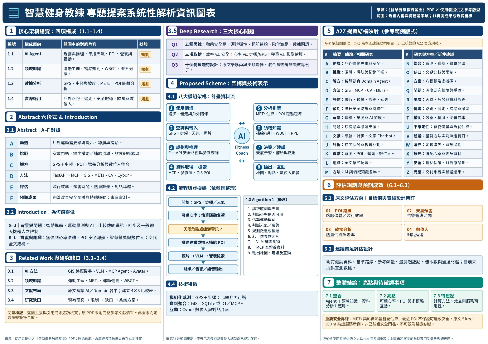
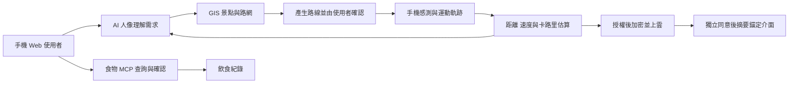
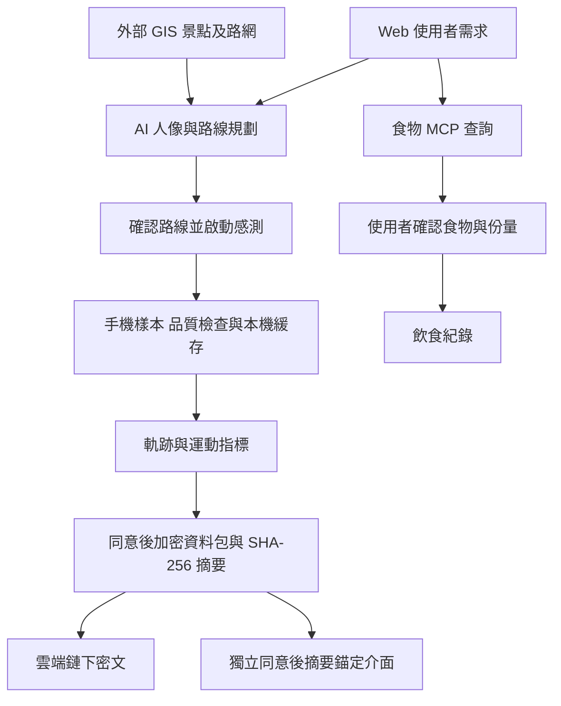

# AI Fitness Coach — A2Z 研究提案

**研究題目：** 以手機感測與 GIS 為基礎之輕量化戶外運動軌跡分析及景點互動系統  
**English title:** A Lightweight Smartphone-Sensing and GIS Framework for Outdoor Activity Tracking and Point-of-Interest Interaction  
**版本：** 研究方向重整｜2026-11-25  
**專案名稱：** AIOT-DIC3；系統暫稱 AI Fitness Coach。

本文件沿用 A–Z 架構，依據 [A–F 研究構想](A_to_F.md)、[感測資料管理原型紀錄](blockchain-development.md)及本次研究重點重新整理。第一階段以**手機作為唯一必要的個人感測裝置**；GIS、景點及路網資料可由外部服務提供。心率與以心率計算心臟負荷列為第二階段，來源、裝置可行性及驗證方式尚待研究。下列系統、模型與實驗均為研究提案，除明確標示的原型紀錄外，未宣稱已實作或驗證。



*圖 1：原始構想圖，供背景參考；本文以手機感測、軌跡與 GIS 景點互動為主要範圍。*

## Abstract

### A. Attention Getter — 研究背景

戶外步行與慢跑者常同時關注走了多遠、目前速度、運動量，以及沿途有哪些可到訪的景點。智慧型手機內建定位與動作感測能力，具有免額外穿戴裝置的潛力。2025 年臺灣調查所報運動參與率及規律運動率分別為 83.3% 與 35.6% [1]，可作研究動機；兩者差距不能直接歸因於缺少本系統，也不能證明系統會改善運動持續性。

### B. But — 研究問題

手機定位可能漂移、短距離速度不穩定，背景執行與電池消耗也會影響持續收集；直線最近的景點不一定沿路可達。步數、活動類型與身體資料不足時，能量消耗只能作近似估計。沒有心率時，速度、步頻或消耗熱量均不能當成心率、心臟負荷或安全程度的直接量測。

### C. Cure — 提出方法

提出手機 Web 智慧運動系統：使用者透過 AI 人像提出運動需求，由系統結合 GIS 景點與路網規劃路線；使用者確認並運動時，手機收集位置與動作資料，估計軌跡、距離、速度、可用步頻與卡路里。活動後，經授權的運動資料加密上雲，摘要經獨立同意後規劃上鏈；使用者也可透過食物 MCP 查詢及記錄飲食。以品質標記、最低必要收集及可調取樣頻率控制資源使用。

### D. Development — 開發方法

手機 Web 提供 AI 人像、運動與飲食介面；AI 協調 GIS 工具產生路線計畫，手機定位與加速度計提供必要感測，食物 MCP 提供食物查詢工具。手機可用之步數或步頻來源應標記與驗證；地圖、POI 和路網來自 GIS 服務。經同意的資料加密後規劃存放雲端，僅將摘要而非原始個資送往鏈上。第二階段研究手機心率取得與參考量測驗證。

### E. Experiments — 評估

以有參考值的戶外路線與步行測試評估軌跡、距離、速度與步數；比較景點推薦和距離的準確性；比較不同取樣與保存策略的電池、資料量及背景執行表現。卡路里估算需以適當參考方法評估。心率及心臟負荷列為第二階段獨立驗證，不納入第一階段已完成成果。

### F. Findings — 現況與預期

資料管理原型紀錄報告 56 項本機及模擬測試通過 [4]；這些測試不代表軌跡、GIS、耗電、卡路里或心率評估已完成。預期成果是可量測準確性與資源成本的手機運動紀錄及景點互動架構；健康、安全與運動持續性效益有待實證。

**Keywords:** Smartphone Sensing, GIS, Outdoor Activity, Trajectory, Walking Speed, Points of Interest, Energy Expenditure, Lightweight Data Collection.

## I. Introduction

### G. General — 研究情境

使用者攜帶手機步行或慢跑時，手機可作為位置與動作的主要資料來源。將軌跡與周邊景點結合，可研究運動過程中的距離感知、景點探索與路線互動，而不要求額外穿戴感測器。

### H. However — 主要挑戰

| 挑戰 | 研究問題 |
|---|---|
| 軌跡與距離 | GPS 漂移、遮蔽及不規則取樣如何影響路徑長度？ |
| 步行速率 | 如何由有效位置與時間估算速度，並處理靜止與缺測？ |
| 景點互動 | 景點距離、路網可達性與使用者選擇如何結合？ |
| 能量消耗 | 資料不齊時如何呈現 MET 估算及其限制？ |
| 輕量化 | 如何在誤差、電量、資料量與運行時間間取得平衡？ |
| 心臟負荷 | 第一階段缺乏心率，如何避免做出沒有依據的生理推論？ |

### I. In Literature — 既有方法

活動紀錄系統可利用手機位置記錄運動 [2]；GIS 地圖與 POI 資料則支援位置查詢及路線規劃。後續須補充經同儕審查的手機定位誤差、步行速度、MET 與手機心率研究，才能完整比較文獻；現有資料不足以宣稱本方法優於既有產品。

### J. Judgement — 可行性與限制

| 面向 | 評估 |
|---|---|
| 優勢 | 不強制購置穿戴裝置；以既有手機進行個人感測 |
| 限制 | 手機型號、攜帶方式、定位環境及作業系統影響結果 |
| 機會 | 將路徑量測與附近景點探索連結 |
| 風險 | 電量消耗、背景限制、定位資料隱私與估算誤差 |

### K. Keypoint — 研究貢獻

研究擬貢獻：(1) 手機位置與動作資料的輕量化軌跡及步行指標管線；(2) 將軌跡、距離與景點互動結合的 GIS 方法；(3) 準確性、資料量、耗電與背景執行的共同評估；(4) 清楚區分活動量估算與第二階段生理量測的設計。這些為待驗證的研究目標，不宣稱全球首創。

### L. List — 論文組織

第二章整理相關方法；第三章提出資料流程、公式、架構與演算法；第四章說明比較、測試條件與結果；第五章討論結論、限制與下一階段。

## II. Related Work

### M. Methods — 方法分類

| 類別 | 方法 | 關注點 |
|---|---|---|
| 手機軌跡 | 定位點、時間戳與品質過濾 | 距離與路徑誤差 |
| 手機動作感測 | 加速度或系統步數資料 | 步數、步頻及攜帶方式 |
| GIS／景點互動 | POI 檢索、直線距離與路網 | 距離定義、可達性及更新 |
| 能量估算 | 活動對應 MET、體重、時間 | 參數來源及個體誤差 |
| 第二階段生理量測 | 可行手機心率方法及參考量測 | 條件、誤差、適用範圍 |

### N. New Proposed — 研究定位

以手機 Web 的 AI 人像規劃路線、手機感測與 GIS 景點互動為主要使用體驗，並納入食物 MCP 查詢與紀錄、運動資料上雲及摘要上鏈。各項整合均屬目標架構；領域工具負責計算和查詢，AI 不自行捏造距離、熱量或營養數值。

### O. Organize — 研究方法比較

| 方法 | 輸入 | 輸出 | 優勢 | 主要限制 |
|---|---|---|---|---|
| 手機原始定位 | 手機位置、時間 | 軌跡、距離、速度 | 較簡單 | 漂移及不規則取樣 |
| 過濾後定位 | 同上及品質資訊 | 經品質控管的運動指標 | 可比較處理前後差異 | 過濾可能遺漏真實路徑 |
| 軌跡結合 GIS | 上述資料與 POI／路網 | 附近景點、距離、路線 | 情境互動 | 外部資料時效與覆蓋 |
| 第二階段心率整合 | 手機心率量測及參考值 | 經驗證之心率與衍生指標 | 可探索個人反應 | 方法與準確性尚待驗證 |

## III. Proposed Scheme — P

### PA. Aim — 目標與階段

第一階段整合手機 Web、AI 人像路線規劃、手機感測、GIS 互動、運動資料上雲及摘要上鏈介面，並提供食物 MCP 查詢與紀錄；量測感測精度與輕量化成本。第二階段研究手機取得心率、參考驗證及可否計算心率相關負荷。第一階段不輸出估計心率或心臟負荷數值；上鏈與完整整合的現況仍以來源紀錄為準。

### PB. Based on — 設計依據

以帶時間戳與品質資訊的位置樣本、加速度或系統步數來源、GIS 距離及路網資料為基礎。MET 是估算活動能量的方法，並非心臟負荷測量。相關公式與數據來源需在論文完成前補足原始文獻及使用條件。

### PC. Cure — 方法與限制

依權限與取樣設定收集資料；濾除不可靠或不合理定位點並保留品質標記；以有效位置及時間推算距離和速度；以 GIS 查詢候選景點，明示直線或路網距離；依使用者選擇顯示景點資訊。無足夠資料時提示無法估算，不以零值代替缺失值。

### PD. Design — 架構

系統包含手機 Web 與 AI 人像、路線規劃與 GIS 工具、手機感測與活動分析、食物 MCP，以及雲端資料與摘要錨定模組。AI 人像接收使用者需求，透過工具查詢景點與路網並提出路線；使用者確認後再開始運動。手機是必要的個人感測端；GIS、食物資料與路網來自外部服務。LLM 與 MCP 負責理解及工具協調，不取代定位或數值驗證。原型加密資料管理與完整教練系統尚未證實端到端整合 [4]。

### PE. Elements — 模組

| 模組 | 輸入 | 輸出 |
|---|---|---|
| Web 與 AI 人像 | 使用者運動目標、偏好及互動 | 路線規劃請求、可確認的建議與回饋 |
| 手機感測 | 定位、時間戳、可用的加速度／步數 | 帶品質標記的位置與動作樣本 |
| 預處理 | 樣本、權限與設定 | 有效點、缺測及品質標記 |
| 運動分析 | 有效軌跡、活動時間、可用個人資料 | 距離、速度、步頻及卡路里估算 |
| GIS 與互動 | 位置／軌跡、外部 POI 與路網、使用者選擇 | 景點、距離類型、路線或互動紀錄 |
| 食物 MCP | 使用者查詢、確認的食物與份量 | 食物資料、營養估算與經確認的飲食紀錄 |
| 雲端與摘要錨定 | 經授權資料、加密資料包與摘要 | 鏈下密文及經獨立同意的錨定狀態 |
| 輕量化與治理 | 採樣策略、同意及儲存設定 | 資料量／耗電記錄、最少必要資料 |
| 第二階段生理擴充 | 經驗證的手機心率輸入 | 經驗證後才提供心率相關指標 |

### PF. Formulation — 數學模型

令有效位置樣本為 $p_i=(\phi_i,\lambda_i,t_i)$，經度與緯度分別為 $\lambda_i,\phi_i$，$t_i$ 為時間。令 $d_g(p_{i-1},p_i)$ 為適當地理距離函數，且 $I_i$ 表示該段時間、位置品質及速度檢查均有效。候選軌跡長度定義為

$$D=\sum_{i=2}^{n} I_i\,d_g(p_{i-1},p_i).$$

長時間缺測時不可將未知路徑自動視為已知；應標示不完整區間。相鄰有效定位點的平均速率為

$$v_i=\frac{d_g(p_{i-1},p_i)}{t_i-t_{i-1}},\quad t_i>t_{i-1}.$$

速度可在明確時間窗口平滑，參數須在實驗前固定並比較；總平均速度應註明分母為總時間或移動時間。若取得可靠步數 $S$，在時間窗口 $\Delta t$ 內的步頻為 $c=S/\Delta t$，單位須一致（如步／分鐘）。加速度推估步數的方法與是否可行均待實作驗證。

使用者位置 $p$ 與景點 $q$ 的直線距離為 $d_g(p,q)$；若有路網及路線資料，另以 $d_{route}(p,q)$ 表示可行路徑距離。兩者不可混為一談；無路網結果時顯示未知或僅標示直線距離，不能宣稱可達。

估算總能量消耗（kcal）可採：

$$E=\frac{MET\times3.5\times m_{kg}\times t_{min}}{200}.$$

其中 MET 的活動對應、體重及有效運動時間須明示來源與假設；缺少必要輸入時不產生個人熱量數值。此式為近似總消耗，非個人實測或心臟負荷。

輕量化以實驗測量資料量 $B$、觀察期間電池消耗 $P$ 與執行時間 $T$；可報告每小時資料量 $B/T$ 和每小時電量變化 $P/T$。電量單位與裝置基準須一致，避免直接將不同手機的百分比視為同等能量。

### PG. Graph — 系統執行與資料流程圖



*圖 2：第一階段概念架構；GIS 為外部資料來源，缺失及失效須明確呈現。*



*圖 3：目標資料流與邊界；食物紀錄與感測密文分開表示，雲端與上鏈的完整整合仍待驗證。*

### PH. How — 資料流程文字說明

1. 使用者用手機開啟 Web，向 AI 人像提供目的、偏好與時間等需求。AI 協調 GIS 查詢景點及路網，提出路線、距離與依據，由使用者確認；資料不足時說明限制。
2. 使用者確認定位與動作權限後開始運動。手機提供位置、時間及可用動作資料；系統檢查品質與時間連續性，本機緩存並標記缺測，不把未觀測路徑當成已量測軌跡。
3. 分析模組計算有效距離與速度；有可信步數來源時提供步頻，活動、體重及時間等必要資料足夠時估算卡路里。使用者可查看沿途景點、距離類型及可用路線。
4. 活動後依授權打包及加密資料，將密文與摘要送往雲端保存；摘要上鏈須另行同意，只錨定摘要而非原始個資。原型目前實際鏈寫入停用；GPS 軌跡上雲、真實交易與完整端到端流程仍待實作驗證。
5. 使用者可另透過 AI 人像或 Web 查詢食物；系統呼叫食物 MCP 取得可用資料，確認品項與份量後建立飲食紀錄，並說明營養估算來源與限制。食物紀錄的保存及授權應明確設計，目前不假定已納入感測密文或上鏈。

### PI. Implementation — 偽程式碼

```text
Input: 手機權限、活動設定、使用者需求
Output: 帶品質標記的活動摘要與景點互動資訊
1. Web 啟動 AI 人像，取得需求並查詢 GIS，提出路線供使用者確認。
2. 確認感測與保存授權；活動期間收集手機位置與動作樣本。
3. 檢查品質及缺測，計算距離、速度與可用步頻。
4. 參數齊備時估算卡路里；呈現沿途景點與資訊限制。
5. 活動結束後依授權加密上傳，計算摘要；獨立同意後請求摘要錨定。
6. 使用者查詢食物時呼叫食物 MCP，確認品項與份量後記錄。
7. 回報雲端與錨定狀態、資料不足或服務失敗，不捏造結果。
```

第二階段才新增經驗證的手機心率資料流；心率不可由上述步速公式推導。

### PJ. Jump to Example — 概念情境

使用者開啟手機 Web，請 AI 人像規劃經過附近景點的步行路線。確認路線後，手機記錄有效定位點並顯示路徑、距離與速度；直線與路網距離分別標示。活動結束後，使用者同意加密資料上雲，並可另行同意摘要錨定；亦可查詢並確認一份食物紀錄。定位失效區間標記缺測，未提供體重時不顯示個人化卡路里數值。此為目標使用情境，不是實測結果。

### PK. Key Points — 資料治理

僅收集任務必要資料，明確處理定位同意、保存期間、刪除及分享。現有資料管理原型描述加速度資料經 IndexedDB、AES-256-GCM、SHA-256 與 Worker／D1 相容介面處理 [4]；錨定須獨立同意、真實鏈寫入目前停用。公開摘要與加密錄製資料分離，不應推論原型已處理本文所有 GPS 或景點資料。

### PL. Later Simulation — 測試銜接

固定路線、參考距離與時間，對比原始定位及不同品質／取樣策略；另比較直線與路網距離的景點排序和使用者互動。對同一裝置、路線與測試條件測量耗電與資料量。第二階段的心率量測需獨立制定參考儀器與測試條件。

### PM. Mathematical Properties — 限制與可解釋性

當 $I_i\in\{0,1\}$ 且地理距離非負時，所報有效區間距離 $D\geq0$；這不保證 $D$ 等於實際路徑長度。定位漂移可能高估，過濾與缺測可能低估。有限取樣得到的速度是區間平均，不是連續瞬時速度；精度需由測試而非公式保證。

## IV. Simulation and Evaluation

### Q. Quality and Quantity — 指標

| 項目 | 指標 | 參考依據 |
|---|---|---|
| 軌跡／距離 | 路徑偏差、距離絕對誤差 | 經測量路線或可信參考軌跡 |
| 步行速率 | 速度 MAE、不同速度區間誤差 | 已知距離與計時或適當參考設備 |
| 步數／步頻 | 步數誤差、步頻誤差 | 人工計數或經驗證參考 |
| POI 互動 | 景點資料有效率、距離誤差、互動完成率 | 事先核對的 POI 與路網資料 |
| 卡路里 | MAE、適用時 MAPE | 合適參考方法及明確活動條件 |
| 輕量化 | 資料量、電池變化、執行時間、缺測率 | 相同裝置與控制條件 |
| 路線規劃與人像 | 需求符合率、路線確認及任務完成時間 | 預先定義情境與使用者測試 |
| 食物 MCP | 查詢成功率、品項與份量確認、紀錄完成率 | 已核對食物資料與任務紀錄 |
| 雲端與錨定 | 上傳成功率、摘要驗證與錨定狀態、延遲 | 控制測試與經授權的真實交易驗證 |
| 第二階段心率 | 心率誤差、有效讀數比例 | 同步、經驗證的參考量測 |

對估計值 $\hat y_i$ 與參考值 $y_i$，$MAE=\frac{1}{n}\sum_i|\hat y_i-y_i|$；$MAPE=\frac{100}{n}\sum_i|\frac{\hat y_i-y_i}{y_i}|$ 僅用於非零參考值，零值另報絕對誤差與樣本數。

### R. Related Methods — 比較基準

比較原始定位與品質過濾方法；比較固定取樣與候選低負載取樣策略；景點比較直線距離排序與可用路網距離排序。統一輸入快照、有效候選及評估條件，避免將地圖資料差異誤歸因於演算法。

### S. Setting — 實驗設計

規劃不同步行速度、手機攜帶位置、開闊與遮蔽環境及多種手機，記錄作業系統、定位權限、背景設定與天候。路線長度、參與人數、測試次數、招募與統計方法尚未決定，正式實驗前須預先定義。

### T. Parameters — 參數

定位頻率、品質門檻、速度平滑窗口、缺測門檻、POI 搜尋半徑與保存策略均為待調參數；須公布單位、設定範圍與固定方式。第二階段心率方法、量測條件及擷取頻率另行研究。

### U. Outcome — 結果

目前尚無第一階段完整軌跡、景點、速度、熱量或資源消耗比較結果，也無第二階段心率與心臟負荷驗證結果。表格與圖形應在取得實測數據後填入，不以預期值替代結果。

### V. Validation — 有效性

分析各手機、攜帶方式、GPS 遮蔽、路網版本及使用者資料完整度對結果的影響；報告失敗、缺測和不提供估算的比例。取得適當同意與倫理審查要求，避免公開可識別軌跡。卡路里與生理相關結果均不作醫療診斷或安全保證。

## V. Conclusion

### W. Wrap-up — 研究總結

本研究以手機 Web 與 AI 人像規劃運動路線，結合手機感測、GIS 景點互動、有條件的卡路里估算、食物 MCP，以及經同意的資料上雲與摘要錨定，並量測資料量、耗電與品質取捨。

### X. eXtension — 第二階段

研究在不增加必要穿戴裝置的前提下，手機可用的心率取得方式、操作負擔、活動時可用性與參考量測誤差；只有在資料與方法經驗證後，才進一步定義與評估心率相關負荷指標。若手機方案無法滿足條件，須明確呈現限制，再評估其他方案。

### Y. Yield — 目前成果

截至 2026-11-25 的來源紀錄載明 56 項資料管理、助理、數位人及音訊相關本機／模擬測試通過 [4]。該紀錄並未重新執行，且不代表本提案的 GPS、GIS 或心率性能已獲驗證。

### Z. Zero in — 後續工作

優先串接 Web 人像、GIS 路線規劃及手機感測，建立食物 MCP 查詢與紀錄，並驗證經授權資料上雲及摘要錨定的端到端流程；以參考路線量測準確性與耗電。真實上鏈前須驗證交易與權限；之後再評估心率量測。

## References

1. 公共電視新聞網，2025 年臺灣運動現況調查報導：https://news.pts.org.tw/article/787192
2. Strava，手機活動紀錄說明：https://support.strava.com/en-us/articles/15402137-how-do-i-record-an-activity-on-strava
3. AIOT-DIC3，[A–F 研究構想](A_to_F.md)。
4. AIOT-DIC3，[區塊鏈感測資料系統開發紀錄](blockchain-development.md)，2026-11-25；資料與測試結果依來源紀錄，未重新執行。

後續應補入定位、步數、運動能量估算、GIS 與手機心率量測的原始研究與技術依據。
